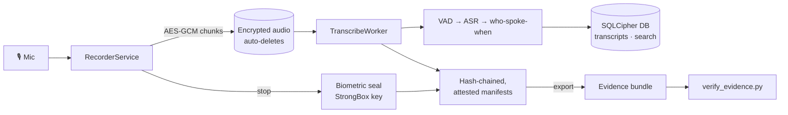

<div align="center">

```
                                    ░█▓▓▓██
                                     ▓▒▒▓██
                                     ▓░░▓██
                                     ▓░░▓██
                     ░               ▓░░▓██
                   ░▒░▓█░            ▓░░▓██
                   ▓░ ▓█▓            ▓░ ▒██
                   ▓░░▓█▓   ▒▒▓▓     ▓▒ ▒██░
           ▒▒░▓▓   ▓░ ▒█▓  ▒▒ ▒█▓    ▒▒ ▒██░
 ▒░░░░     ▓  ▓█░  ▓░ ▒█▓  ▒▒ ▒█▓    ▒▒ ▒██░
▒▓░▓██░    ▓ ░▓█░  ▓░ ▓█▓  ▒▒ ▒█▓    ▒▒░▒██░
▓░ ▒██     ▓░░██░  ▓░░▒█▓  ▒▓░▓█▓    ▒▒░▒██░
▓░ ▓█▓     ▒▓██▒   ▓░░▓█▓   ▓▓██░    ▒▓░▒██░
█░░▒█▓             ▓░░▓█▒            ▓▒░▓██░
▓▓░▒██░            ▓▓▓██░           ░▓░░▓██
░█▒░▒▓█▒░           ░▒▒░          ░▒▒░░▓██▒
 ░█▓▒░░▒▒▒▒▒░░░░░░░░   ░░░░░░░░░░▒░░░▒▓██▒
   ▓██▓▒▒▒░░░░░░░░░░░▒▒░▒░▒▒▒▒▒▒▒▒▓▓███▓░
     ░▒▓▓█▓███▓▓▓▓▓█▓▓▓████████████▓▓▒░
           ░░░▒▒▒▒▒▒▒▒▒▒▒▒▒▒▒▒░░░


 ██╗  ██╗  █████╗  ████████╗ ██╗ ██████╗
 ██║ ██╔╝ ██╔══██╗ ╚══██╔══╝ ██║ ██╔══██╗
 █████╔╝  ███████║    ██║    ██║ ██████╔╝
 ██╔═██╗  ██╔══██║    ██║    ██║ ██╔══██╗
 ██║  ██╗ ██║  ██║    ██║    ██║ ██████╔╝
 ╚═╝  ╚═╝ ╚═╝  ╚═╝    ╚═╝    ╚═╝ ╚═════╝
                 ك ا ت ب
```

### The meeting recorder that doesn't send your meetings anywhere.

**On-device transcription · Arabic + English · Signed, tamper-evident transcripts · No cloud. At all.**


</div>

---

## Why didn't anyone build this already?

Every transcription app makes the same pitch: *give us your audio and we'll give you words back.*
It's a reasonable deal, until you remember what gets said in meetings. Salaries. Diagnoses.
Acquisitions. The thing the CEO said that the CEO would like to un-say.

The industry treats privacy as a feature you add. We think that's backwards.
**For a recorder, privacy isn't a feature. It's the whole product.** Everything else is a nice extra.

So Katib makes a promise that's easy to say and hard to fake:

```
   ┌──────────────────────────────────────────────────────────────┐
   │                                                              │
   │   Your audio is recorded on your phone, transcribed on your  │
   │   phone, encrypted on your phone, and deleted from your      │
   │   phone. Nobody else ever handles it. We don't either.       │
   │                                                              │
   └──────────────────────────────────────────────────────────────┘
```

That isn't a policy. It's how the app is built. Katib has no server to send your audio to.
You can check this in the code, which is the point of making it open source.

---

## A promise vs. a fact

Cloud transcription vendors work hard to reassure you. There's a trust center, a SOC 2 report,
an ISO certificate, a DPA, a list of subprocessors, and a policy saying your data won't be used
for training. Much of it is real work by serious people, and it's worth having.

But look at what all of it is: **evidence that someone is keeping a promise.** Audits check
whether controls were followed in the past. Policies describe what a company plans to do
from now on. Neither can stop the audio from being somewhere it could be misused.
A trust center is the building you need once you've asked to be trusted.

A promise can be broken by things that have nothing to do with anyone's good intentions:

```
  the terms of service get "updated"       the company gets acquired
  a new subprocessor appears in a list     a court order arrives
  a model needs more training data         an admin account gets phished
  a misconfigured bucket                   a startup runs out of money
```

Katib doesn't ask you to trust anyone's behaviour, because nothing is sent anywhere.

```
                         CLOUD TRANSCRIPTION          KATIB
  where audio goes       their servers                nowhere
  why you're safe        they promise                 it's not possible
  how you check          read their audit report      read the code
  if they change mind    you find out later           there's no "they"
  breach blast radius    every customer at once       one phone, encrypted
```

The most reassuring thing a vendor can say isn't *"we'll never look at your data."*
It's *"we can't."*

> **Fair warning, from people who care about this stuff:** Katib doesn't remove trust, it
> moves it. You still rely on your phone's hardware and OS, Google's attestation root, and the
> code in this repo. The difference is that you were already trusting the first two, and you
> can audit the third yourself.

---

## A recorder that behaves like a guest

People talk differently when a phone is recording, and they should. Katib leans into that
instead of pretending it isn't happening.

```
    BEFORE                       DURING                      AFTER
 ┌───────────────┐        ┌───────────────────┐       ┌────────────────────┐
 │ Who's here?   │        │  ● REC   12:04    │       │ Transcript, signed │
 │ Did everyone  │  ───►  │  ▁▃▅▇▅▃▁▃▅▇▅▃▁    │  ───► │ Audio auto-deletes │
 │ say yes?      │        │  persistent notif │       │ in 5 days          │
 └───────────────┘        └───────────────────┘       └────────────────────┘
   consent, logged          impossible to hide          the words stay,
   before the mic opens     you're recording            the voices don't
```

- **Consent first.** In meeting mode, the record button stays disabled until you confirm that
  everyone present agreed. That confirmation is logged and signed.
- **Personal notes skip the ceremony.** Recording yourself doesn't need a consent form. If Katib
  later hears voices that don't match yours, it flags the note.
- **Audio is temporary by design.** The recording deletes itself after 5 days (you can change this)
  and the file is overwritten before removal. The transcript stays. Keeping less is the
  cheapest security there is.

---

## Transcripts you can stand behind

A transcript is only as good as your ability to prove nobody touched it. So Katib signs every
recording and transcript with keys that live in your phone's secure hardware:

```
  capture ──sign(you, biometric)──►  manifest #0   audio_sha256, consent, time, place?
                                          │
  transcribe ──sign(device)────────►  manifest #1   transcript_sha256, model hash, prev ─┐
                                          │                                              │
  you fix a typo ──sign(device)────►  manifest #2   transcript_sha256', prev ◄───────────┘
                                          │
                                   evidence bundle  ──►  tools/verify_evidence.py  ──►  VALID ✓
```

- **Who:** a signing key that only works after a fingerprint or face check, and never leaves the
  StrongBox/TEE chip.
- **Which device:** Android Key Attestation, a certificate chain rooted in Google's hardware
  attestation root. It shows the key is genuinely hardware-backed, the bootloader is locked,
  and the signature came from this app.
- **What changed:** each transcript manifest includes the hash of the one before it, forming a
  hash chain. Edits aren't hidden. They're recorded.
- **Anyone can check:** `tools/verify_evidence.py` verifies a bundle on any computer, with no
  account and nothing of ours involved.

> A signature you can't verify is just decoration. This one you can verify.

---

## Bilingual, and not as an afterthought

The interface is designed right-to-left first, and English is its mirror image.
Transcription runs locally, at about **0.7× real time** on a Galaxy S23 Ultra (an hour of meeting
in roughly 45 minutes, in your pocket, offline).

| | |
|---|---|
| **Languages** | Arabic (Gulf dialect + Modern Standard Arabic), English. Auto-detect or pinned |
| **Speech recognition** | Qwen3-ASR 0.6B (int8), or Whisper base for speed |
| **Who said what** | pyannote segmentation + WeSpeaker embeddings, clustered on-device |
| **Know your voices** | Optional voice profiles, matched locally. Embeddings are never exported |
| **Find anything** | Full-text search across every meeting, inside the encrypted database |

---

## Security, the boring version

The parts that matter, listed plainly:

```
 audio      AES-256-GCM, 1-second chunks, per-file key wrapped by an Android Keystore key
 database   SQLCipher (Room + FTS4), passphrase wrapped by the Keystore
 signing    EC P-256 in StrongBox (TEE fallback); user key requires biometric per use
 app        biometric lock · FLAG_SECURE (no screenshots) · backups disabled
 network    used only to download speech models; SHA-256 checked. Audio never uploaded.
 location   off by default; opt in per recording; platform API, no Google Play services
```

### How it fits together



**Design:** ink on paper, hairline rules, an editorial serif (Amiri for Arabic), and one
vermilion reserved for live states. Tokens live in [`design/tokens.json`](design/tokens.json)
(primitive → semantic → component) and are mirrored in `ui/Tokens.kt`.

**Go deeper:** [Architecture](docs/ARCHITECTURE.md) (components, lifecycle, storage format,
pipeline, provenance) · [Threat model](docs/THREAT_MODEL.md) (assets, adversaries, STRIDE,
and what Katib does *not* protect against).

---

## Get it running

```bash
git clone https://github.com/BlackDuck314/katib.git && cd katib
echo "sdk.dir=$HOME/Android/Sdk" > local.properties   # your Android SDK path
./gradlew :app:installDebug                          # arm64 device, Android 10+
```

On first launch, open **Settings → Models** to download the speech models (about 1 GB; this is
the only time Katib uses the network). After that, record.

**Verify an evidence bundle** (exported from the meeting's ⋮ menu):

```bash
pip install cryptography
python3 tools/verify_evidence.py evidence-42.json --audio original.wav
```

---

## Status: alpha, and honest about it

```
 [x] on-device recording, transcription, speaker separation
 [x] encrypted storage, app lock, retention + shredding
 [x] consent log, personal-note mode, optional location
 [x] hardware-attested, hash-chained signatures + standalone verifier
 [ ] trusted timestamps (countersigned by your own server)
 [ ] SSH sync to a server you control (transcripts only, never audio)
 [ ] SRT / JSON export, legal hold
 [ ] Gulf Arabic accuracy benchmark
 [~] mid-sentence switching between several languages: works poorly so far
```

Tested on one phone (Galaxy S23 Ultra, Android 17). Bug reports from other devices are very
welcome.

---

## A note on the law

Katib was designed with the UAE Personal Data Protection Law (PDPL) and all-party-consent rules
in mind. Software can support compliance, but it can't give it to you. Whether recording a
particular conversation is lawful depends on where you are and who's in the room.
**Nothing here is legal advice.**

---

## Built on

[sherpa-onnx](https://github.com/k2-fsa/sherpa-onnx) · [Qwen3-ASR](https://github.com/QwenLM) ·
[Whisper](https://github.com/openai/whisper) · [Silero VAD](https://github.com/snakers4/silero-vad) ·
[pyannote](https://github.com/pyannote/pyannote-audio) · [WeSpeaker](https://github.com/wenet-e2e/wespeaker) ·
[SQLCipher](https://www.zetetic.net/sqlcipher/) · [IBM Plex](https://github.com/IBM/plex).
Licences for these are listed in [THIRD_PARTY_NOTICES.md](THIRD_PARTY_NOTICES.md).

## License

[MIT](LICENSE). Use it, fork it, ship it. Just don't add a cloud upload and keep the name.

<div align="center">

```
 ─────────────────────────────────────────────
   كاتب  ·  "the one who writes it down"
 ─────────────────────────────────────────────
```

</div>
