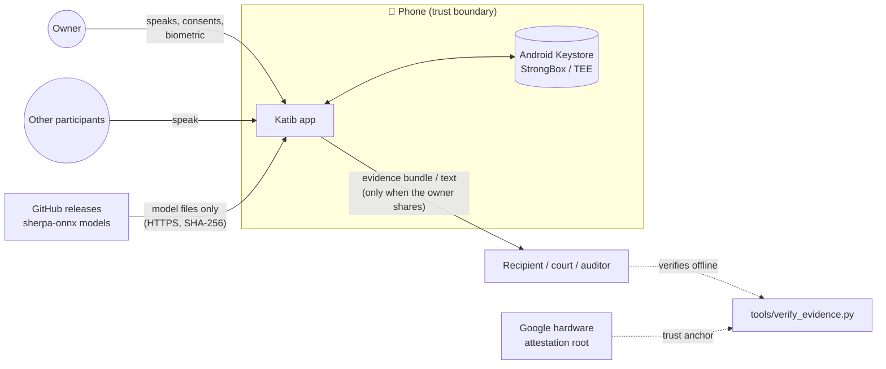
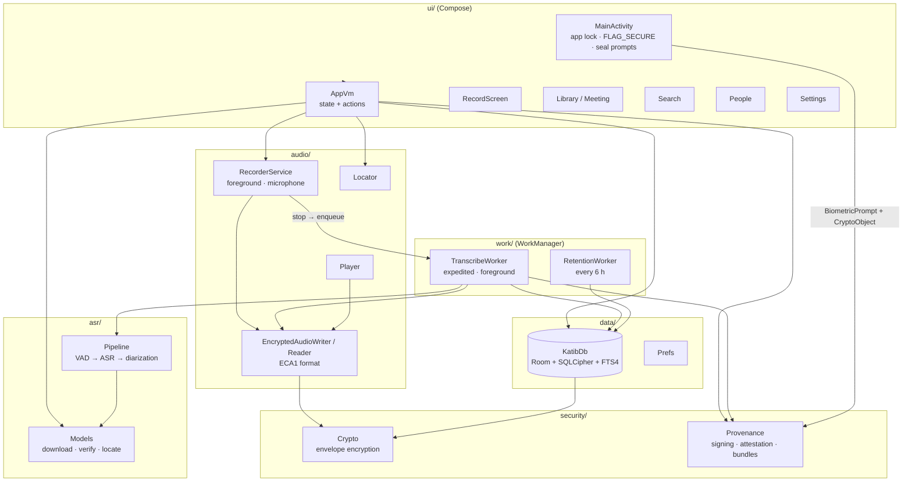
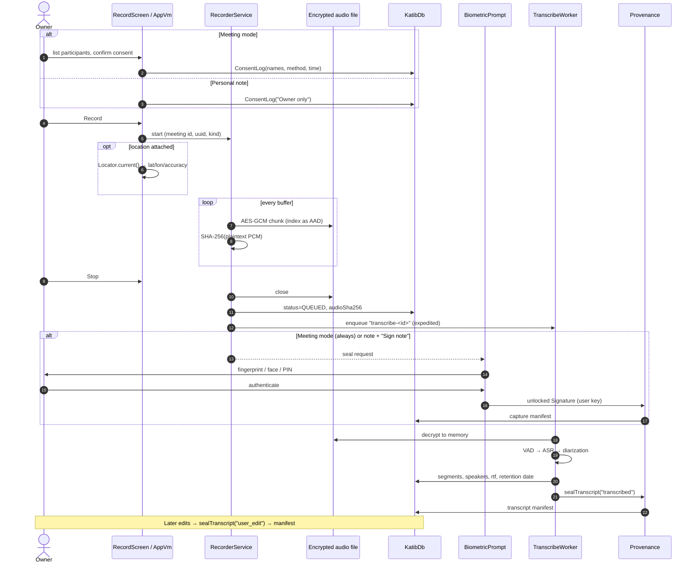
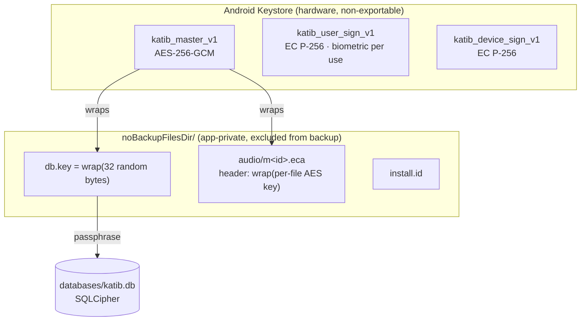
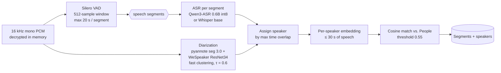
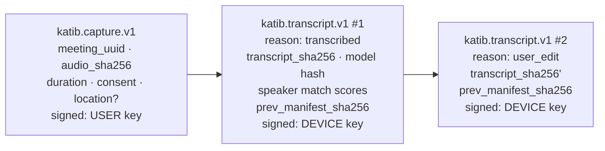
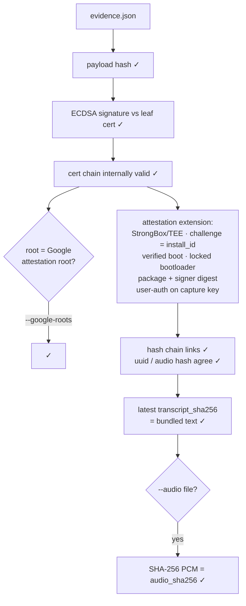

# Katib architecture

Katib is a single Android app (Kotlin, Jetpack Compose) with no backend. Everything in this
document runs on the phone. The only network calls are speech-model downloads from the
sherpa-onnx GitHub releases.

- [1. System context](#1-system-context)
- [2. Components](#2-components)
- [3. Recording → transcript lifecycle](#3-recording--transcript-lifecycle)
- [4. Storage and encryption](#4-storage-and-encryption)
- [5. Speech pipeline](#5-speech-pipeline)
- [6. Provenance: signing and evidence](#6-provenance-signing-and-evidence)
- [7. Retention and deletion](#7-retention-and-deletion)
- [8. Data inventory](#8-data-inventory)
- [9. Build and platform](#9-build-and-platform)

---

## 1. System context



Nothing flows out of the phone unless the owner presses **Share** or **Export evidence**.
Audio is never uploaded.

---

## 2. Components



| Package | Responsibility |
|---|---|
| `audio/RecorderService` | Foreground service (`microphone` type). Reads 16 kHz mono PCM from `AudioRecord` (`VOICE_RECOGNITION` source), streams it to an encrypted file, computes the plaintext SHA-256 as it goes, publishes level/duration as a `StateFlow`. |
| `audio/EncryptedAudio` | `ECA1` chunked AES-GCM container. Random access by 1-second chunk for playback and seeking. |
| `work/TranscribeWorker` | Expedited, foreground `CoroutineWorker`. Decrypts audio into memory, runs the pipeline, writes segments, matches speakers, seals the transcript. Survives app kill; orphaned jobs are re-queued at startup. |
| `work/RetentionWorker` | Periodic. Shreds audio past its delete-at time. |
| `asr/Pipeline` | sherpa-onnx inference: Silero VAD, Qwen3-ASR or Whisper, pyannote + WeSpeaker diarization, voice enrollment. |
| `asr/Models` | Model catalogue, HTTPS download, SHA-256 check (pinned for every model), tar.bz2 extraction. |
| `security/Crypto` | Keystore master key; wrap/unwrap data keys; DB passphrase; crypto-wipe. |
| `security/Provenance` | Signing keys, Key Attestation chains, canonical payloads, hash-chained manifests, evidence bundles. |
| `data/KatibDb` | SQLCipher-encrypted Room database: meetings, segments (+FTS), speakers, people, consent log, provenance records. |
| `ui/MainActivity` | Biometric app lock (after 60 s in background), `FLAG_SECURE`, and the biometric signing prompt for capture seals. |

---

## 3. Recording → transcript lifecycle



Meeting status moves through `RECORDING → QUEUED → PROCESSING → DONE` (or `FAILED`, with a
retry action). Progress and stage (`vad`, `asr`, `diarize`) are written to the DB, and the UI
observes them.

---

## 4. Storage and encryption



**Envelope encryption.** One AES-256-GCM master key in the Keystore never leaves hardware. It
only wraps small random data keys:

- each audio file has its own 256-bit key, stored wrapped in the file header;
- the SQLCipher passphrase is a random 32 bytes, stored wrapped in `db.key`.

**ECA1 audio format.**

```
"ECA1" | sampleRate:i32 | wrappedKeyLen:i32 | wrappedKey | record*
record = iv(12) | AES-GCM(ciphertext of 1 s of s16le PCM) + tag(16)     AAD = chunk index
```

Chunk indices are bound as AAD, so chunks can't be reordered or swapped undetected. Truncation
of trailing chunks is detectable by comparing to the signed `audio_sha256` and duration.

**Wipe everything** deletes the master key and `db.key`. All ciphertext on the device becomes
unreadable, regardless of flash wear-levelling.

**Platform hardening.** `allowBackup=false`, data-extraction rules exclude everything,
`FLAG_SECURE` on the window (no screenshots, recents thumbnails or casting), notifications use
`VISIBILITY_PRIVATE`, and the app requires biometric/device credential after 60 s in the
background.

---

## 5. Speech pipeline



- **Language.** Auto-detect, or pinned to Arabic or English (`language` option for Qwen3).
- **Voice enrollment.** About 30 s of reading → VAD → embedding. A consistency check compares
  embeddings from each half; under 0.35 is rejected as noisy. At least 6 s of speech is required.
- **Personal notes.** If a cluster doesn't match the enrolled owner, the note is flagged
  "other voices", since a note was supposed to contain only the owner.
- **Performance.** Galaxy S23 Ultra (Snapdragon 8 Gen 2): about 0.73× real time with Qwen3-ASR.
- Speaker **embeddings never leave the phone** and are never written into signed manifests or
  exports.

---

## 6. Provenance: signing and evidence

Two hardware keys, both with an Android Key Attestation chain whose challenge is this install's
random `install_id`:

| Key | Auth | Signs | Proves |
|---|---|---|---|
| `katib_user_sign_v1` | biometric or device credential, **every use** | capture manifests | a person who could unlock this phone approved this recording |
| `katib_device_sign_v1` | none | transcript manifests | this app on this device produced this transcript |

### Manifest chain



**Canonical transcript** (what `transcript_sha256` covers), sorted by start time then id,
`Locale.ROOT`:

```
<start %.2f>\t<end %.2f>\t<speaker index>\t<text>\n
```

### Evidence bundle (`katib.evidence.v1`)

An exported JSON file that contains every manifest (payload, SHA-256, signature, PEM cert
chain), the current transcript text and the device info. **Not included:** audio, voice
embeddings.

### Verification (`tools/verify_evidence.py`)



---

## 7. Retention and deletion

| Item | Default lifetime | Mechanism |
|---|---|---|
| Audio | 5 days after transcription (configurable) | `RetentionWorker` every 6 h → overwrite + delete |
| Transcript, segments | until the owner deletes the meeting | DB delete (SQLCipher) |
| Provenance records | deleted with the meeting | DB delete |
| Voice profiles | until deleted in People | DB delete |
| Exported bundles | cache, cleared on next export | `cacheDir/exports` |
| Everything | Settings → Wipe | master key destroyed (crypto-erase) |

Overwriting a file on flash isn't a guaranteed physical erase (wear-levelling,
file-based encryption). Each file's own key goes with it, and the master-key wipe is the real
guarantee. See [THREAT_MODEL.md](THREAT_MODEL.md).

---

## 8. Data inventory

| Data | Personal? | Where | Encrypted at rest | Leaves device |
|---|---|---|---|---|
| Raw audio | yes (voice) | `noBackupFilesDir/audio` | AES-GCM per file | never |
| Transcript text | yes | SQLCipher DB | yes | only if owner shares/exports |
| Speaker embeddings | **biometric** | SQLCipher DB | yes | never |
| Participant names / consent | yes | SQLCipher DB | yes | inside evidence bundle |
| Location | yes | SQLCipher DB | yes | inside evidence bundle (if attached) |
| install_id, device model | pseudonymous | file + DB | install.id: no (random, non-secret) | inside evidence bundle |
| Models | no | `filesDir/models` | no | downloaded from GitHub |

---

## 9. Build and platform

- Kotlin 2.1, AGP 8.7, Compose BOM 2024.12, Room 2.6 + KSP, WorkManager 2.10,
  SQLCipher 4.6, sherpa-onnx 2.0.1 (static AAR, arm64-v8a).
- `minSdk 29` (Android 10), `targetSdk 35`. Tested on Android 17 (Galaxy S23 Ultra).
- Debug builds skip `FLAG_SECURE` only if `files/test/allow_screens` exists (for UI screenshots via adb).
- Debug builds include an exported `DebugImport` receiver for scripted testing (import WAV,
  export bundle). It is in `src/debug` only and **not present in release builds**.
