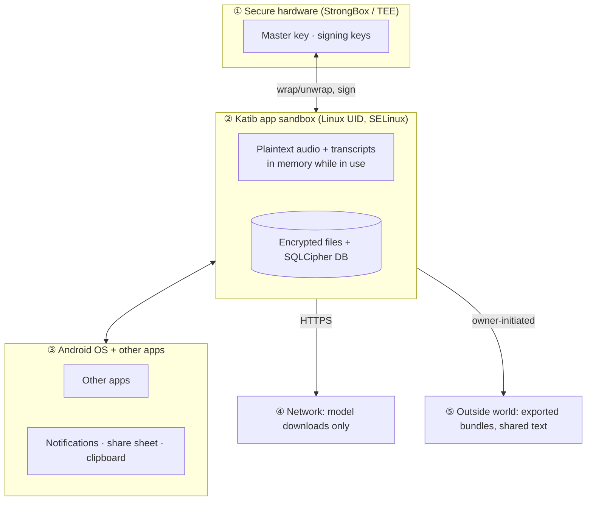

# Katib threat model

> Status: v0.1, alpha. Written by the authors, not externally reviewed. Corrections are welcome
> via issues. For vulnerabilities, see [Reporting](#reporting).

This document follows a simple structure: what we protect, from whom, where the trust
boundaries are, a STRIDE pass over each boundary, and an honest list of what Katib does
**not** protect against.

---

## 1. Assets

| ID | Asset | Why it matters |
|---|---|---|
| A1 | Raw meeting audio | Most sensitive: voices, tone, everything said |
| A2 | Transcripts | Same content, searchable |
| A3 | Voice embeddings | Biometric data; can re-identify a person |
| A4 | Participant names, consent log, location | Personal data, compliance evidence |
| A5 | Signing keys (user, device) | Forging these breaks every provenance claim |
| A6 | Integrity of transcripts and manifests | Legal/compliance value depends on it |
| A7 | Master encryption key | Unlocks A1–A4 |

## 2. Adversaries

| ID | Adversary | Capability |
|---|---|---|
| T1 | **Cloud / vendor / network observer** | Sees network traffic, operates servers |
| T2 | **Thief / finder** | Physical phone, locked; no credentials |
| T3 | **Casual snooper** | Briefly holds an *unlocked* phone |
| T4 | **Malicious app** on the same phone | Normal app permissions, no root |
| T5 | **Forensic lab** | Phone in hand, commercial extraction tools, possibly 0-days |
| T6 | **Dishonest owner** | Wants to fabricate or alter a recording/transcript and pass it off as genuine |
| T7 | **Recipient of an export** | Receives an evidence bundle or shared text |
| T8 | **Supply chain** | Tampers with models, libraries, or the build |

## 3. Trust boundaries

## 4. Security properties we claim

| # | Property | Mechanism |
|---|---|---|
| P1 | Audio is never transmitted | No upload code; the network is used only for model download. Verifiable in source. |
| P2 | Data at rest is unreadable without the device's Keystore | Envelope encryption: AES-GCM audio, SQLCipher DB |
| P3 | Wipe is irreversible | Master key deletion = crypto-erase |
| P4 | Recordings approved by the owner are attributable | User key requires biometric/credential per signature + Key Attestation |
| P5 | Transcripts produced by Katib on a specific device are attributable | Device key + attestation (package, signer, verified boot) |
| P6 | Post-hoc edits are visible | Hash-chained transcript manifests |
| P7 | A third party can verify without trusting us | Offline Python verifier, Google attestation root |

## 5. STRIDE analysis

### Boundary ④: network (T1, T8)

| Threat | Mitigation | Residual risk |
|---|---|---|
| **I**: audio/transcript exfiltration over network | No code path sends them; `INTERNET` used by model downloader only | A malicious build could add one. Build from source or verify signer. |
| **T**: tampered model download | HTTPS + **SHA-256 pinned for every model** (mismatch → file deleted, install fails); model hash recorded in transcript manifest | A compromised upstream release *before* pinning; hashes were cross-checked against copies tested on-device |
| **I**: download reveals Katib usage | Requests go to GitHub, carrying no user data | Network observer learns "this device downloaded ASR models" |

### Boundary ③: OS and other apps (T3, T4)

| Threat | Mitigation | Residual risk |
|---|---|---|
| **I**: other app reads files | App-private storage, `noBackupFilesDir`, everything encrypted | None without root |
| **I**: screenshots, screen recording, recents | `FLAG_SECURE` | Camera pointed at screen |
| **I**: lock-screen notification leaks title | `VISIBILITY_PRIVATE`, generic text | — |
| **I**: cloud backup / device transfer | `allowBackup=false`, data-extraction rules | — |
| **I**: covert recording by Katib itself | Foreground service + persistent notification + OS mic indicator | — |
| **I**: shared text / clipboard | Owner-initiated only | Once shared, out of Katib's control |
| **S**: debug receiver abused | Exists only in debug builds | Don't distribute debug builds |

### Boundary ②: app sandbox (T2, T3, T5)

| Threat | Mitigation | Residual risk |
|---|---|---|
| **I**: snooper opens Katib on unlocked phone | Biometric app lock after 60 s background | ⚠️ App lock is a **UI gate**; the master key itself is not user-auth-bound (needed so transcription runs in the background) |
| **I**: thief with locked phone | Android FBE + Keystore; Katib data is double-encrypted | Depends on device passcode strength and patch level |
| **I**: forensic extraction (AFU / root / 0-day) | Hardware-backed keys can't be exported | ⚠️ An attacker with code execution in the app's context on an unlocked device can use the Keystore to decrypt. **Katib does not defend against a fully compromised OS.** |
| **I**: plaintext in RAM during transcription | Decrypted only for the job | Memory forensics on a live, compromised device |
| **I**: deleted audio recovered from flash | Overwrite + delete; per-file key in header | ⚠️ Flash wear-levelling may retain old blocks. Encrypted with keys that are gone after a wipe, but **not** after a single-file deletion (master key still exists). |

### Boundary ①: secure hardware (T5, T6)

| Threat | Mitigation | Residual risk |
|---|---|---|
| **S**: forge owner signature | Per-use biometric/credential, StrongBox | Anyone who knows the device PIN can authorize (device credential allowed) |
| **S**: extract signing key | Non-exportable, StrongBox preferred | Hardware attacks on secure elements (lab-grade) |
| **R**: owner denies having recorded | Capture manifest signed by user-auth key + attestation | Proves *someone able to unlock the phone*, not a specific human. Biometric ≠ identity. |

### Provenance integrity (T6, T7)

| Threat | Mitigation | Residual risk |
|---|---|---|
| **T**: edit transcript, hide it | Every edit → new manifest chained to previous | Owner can delete the whole meeting (absence isn't detectable without external anchoring) |
| **T**: substitute audio | `audio_sha256` signed at capture; verifier checks `--audio` | — |
| **T**: feed fake audio into the mic (playback, synthetic voice) | **None.** Katib attests *what the phone heard*, not that it was real | ⚠️ Out of scope; deepfake detection isn't attempted |
| **T**: backdate a recording | — | ⚠️ Timestamps come from the device clock. **Trusted timestamping (server countersign) is planned.** |
| **T**: spoof location | Platform location provider, accuracy recorded | ⚠️ Mock-location apps / GPS spoofing aren't detected |
| **R**: "consent was given" | Consent log signed in capture manifest | ⚠️ It's the **owner's attestation** that consent was given, not proof from participants |
| **S**: run Katib on a rooted/modified device to forge | Attestation reports verified boot + bootloader lock + app signer | Verifier must enforce these; a leaked app signing key would let a modified app attest |
| **I**: exported bundle over-shares | No audio, no embeddings | Contains names, location (if attached), device model, install_id. Owner should review before sharing. |

## 6. Explicitly out of scope

- A fully compromised device (root malware, OS 0-days, hostile OEM firmware).
- Someone in the room recording with their own device.
- Coercion of the owner (compelled unlock).
- Proving that audio is a genuine, non-synthetic human voice.
- Legal compliance itself. Katib provides controls and evidence; whether a recording is lawful
  depends on jurisdiction and circumstances.

## 7. Known gaps and roadmap

| Gap | Plan |
|---|---|
| Device-clock timestamps | RFC 3161-style countersign by the owner's own server |
| App lock is UI-only | Option: user-auth-bound key for *viewing* (trade-off: background transcription) |
| Single-file deletion relies on overwrite | Per-file key escrow in DB so deletion = key deletion |
| Deleted meetings leave no trace | Optional append-only deletion log, anchored with timestamps |
| Release signing key management | Documented release process, reproducible builds |

## Reporting

Please report vulnerabilities privately via
[GitHub Security Advisories](https://github.com/BlackDuck314/katib/security/advisories/new)
rather than public issues.
